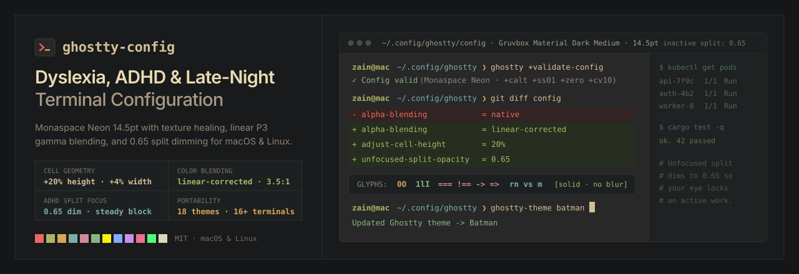

<p align="center">
  
</p>

# Ghostty Config: Dyslexia, ADHD & Late-Night Edition

[](LICENSE)
[](#themes-18)
[](#supported-terminals-and-editors)

Most terminal configs stop at font and theme, which will not fix color haloing, letter crowding, or split-pane distraction. This open-source configuration fixes all three on macOS and Linux.

It runs natively in **Ghostty** and includes adapters for **Cursor**, **VS Code**, **Antigravity**, **Windsurf**, **Superset**, **Zed**, and **Warp**. Additional adapters cover **Alacritty**, **WezTerm**, **Kitty**, **Windows Terminal**, **iTerm2**, **macOS Terminal**, **tmux**, **Linux Fontconfig**, and **Zsh**.

---

## Install with an AI Agent

Paste this prompt into **Claude Code**, **Cursor**, **Antigravity**, **Codex**, **Windsurf**, or **Superset**:

```text
Clone https://github.com/thezaynahmed/ghostty-config.git to ~/.config/ghostty, read AGENTS.md, and run ./install.sh --all to configure Ghostty, Monaspace Neon fonts, and my installed terminals and IDEs. Validate with ghostty +validate-config.
```

---

## Quick Start

### 1. One-Line Install (macOS & Linux)

```bash
curl -fsSL https://raw.githubusercontent.com/thezaynahmed/ghostty-config/main/install.sh | bash -s -- --all
```

This script detects **macOS**, **Fedora**, **Ubuntu**, **Debian**, **Pop!_OS**, **Arch**, or **openSUSE**. It installs **Ghostty** and **GitHub Monaspace v1.400**, links `ghostty-theme`, and configures your tools.

### 2. Targeted Install

```bash
git clone https://github.com/thezaynahmed/ghostty-config.git ~/.config/ghostty
cd ~/.config/ghostty

# Configure specific editors and terminals:
./install.sh --cursor --vscode --antigravity --superset --warp --tmux --zsh

# On Linux, install Fontconfig hinting and OpenType rules:
./install.sh --linux-fontconfig --alacritty --wezterm --kitty
```

### 3. Switch Themes

```bash
ghostty-theme --list
ghostty-theme batman
ghostty-theme ef-dream
ghostty-theme kanagawa-wave
ghostty-theme gruvbox
```

---

## Core Settings

| Setting | Value | Purpose |
| :--- | :--- | :--- |
| `theme` | `Gruvbox Material Dark Medium` | Warm `#282828` background and `#d4be98` sand text stop glare at night. |
| `font-family` | `Monaspace Neon` + `Radon` (`14.5pt`) | Neon renders clean code, while Radon marks italic comments in handwriting style. |
| `font-feature` | `+calt, +ss01..03, +zero, +cv10` | Texture healing widens dense letters (`m`, `w`) next to narrow letters (`i`, `l`). |
| `adjust-cell-height` | `20%` (`+4%` width) | Adds vertical and horizontal breathing room so logs do not blur together. |
| `alpha-blending` | `linear-corrected` | Fixes fuzzy red and green diff fringes on wide-gamut monitors. |
| `font-thicken` | `true` (`strength = 100`) | Adds stroke weight on high-DPI screens so thin letters do not shimmer. |
| `minimum-contrast` | `3.5` | Raises dark-blue and gray CLI flags to a readable contrast ratio. |
| `unfocused-split-opacity` | `0.65` | Dims inactive split panes by 35% so your eyes lock onto active work. |
| `cursor-style-blink` | `false` (`block` + `no-cursor`) | Locks a solid block cursor and stops shells from forcing a blinking bar. |
| `background-blur` | `false` (`opacity = 1`) | Keeps a solid background with zero desktop bleed-through. |

---

## Themes (18)

**15 themes ship built into Ghostty**, and **3 custom or alias files** live in [`themes/`](themes/):

| # | Theme | Command | Source | Background | Foreground |
| :- | :--- | :--- | :--- | :--- | :--- |
| 1 | **`Gruvbox Material Dark Medium`** | `ghostty-theme gruvbox` | Bundled Default | `#282828` | `#d4be98`. |
| 2 | **`Gruvbox Material Dark`** | `ghostty-theme gruvbox-dark` | Ghostty Builtin | `#282828` | `#d4be98`. |
| 3 | **`Batman`** | `ghostty-theme batman` | Ghostty Builtin | `#1b1d1e` | `#c6c5bf`. |
| 4 | **`Night Owl`** | `ghostty-theme night-owl` | Ghostty Builtin | `#011627` | `#d6deeb`. |
| 5 | **`Modus Vivendi Tinted`** | `ghostty-theme modus` | Ghostty Builtin | `#0d0e1c` | `#ffffff`. |
| 6 | **`Ef-Dream`** | `ghostty-theme ef-dream` | Bundled Custom | `#232025` | `#efd5c5`. |
| 7 | **`Ef-Bio`** | `ghostty-theme ef-bio` | Bundled Custom | `#111111` | `#cfdfd5`. |
| 8 | **`Kanagawa Wave`** | `ghostty-theme kanagawa` | Ghostty Builtin | `#1f1f28` | `#dcd7ba`. |
| 9 | **`Kanagawa Dragon`** | `ghostty-theme dragon` | Ghostty Builtin | `#181616` | `#c5c9c5`. |
| 10 | **`Catppuccin Mocha`** | `ghostty-theme mocha` | Ghostty Builtin | `#1e1e2e` | `#cdd6f4`. |
| 11 | **`TokyoNight Storm`** | `ghostty-theme tokyo` | Ghostty Builtin | `#24283b` | `#c0caf5`. |
| 12 | **`Rose Pine`** (`Rosé Pine`) | `ghostty-theme rose-pine` | Ghostty Builtin | `#191724` | `#e0def4`. |
| 13 | **`Rose Pine Moon`** | `ghostty-theme moon` | Ghostty Builtin | `#232136` | `#e0def4`. |
| 14 | **`Everforest Dark Hard`** | `ghostty-theme everforest` | Ghostty Builtin | `#1e2326` | `#d3c6aa`. |
| 15 | **`Dracula`** | `ghostty-theme dracula` | Ghostty Builtin | `#282a36` | `#f8f8f2`. |
| 16 | **`Dracula+`** | `ghostty-theme dracula+` | Ghostty Builtin | `#212121` | `#f8f8f2`. |
| 17 | **`Ayu Mirage`** | `ghostty-theme ayu` | Ghostty Builtin | `#1f2430` | `#cccac2`. |
| 18 | **`Ubuntu`** | `ghostty-theme ubuntu` | Ghostty Builtin | `#300a24` | `#eeeeec`. |

---

## Supported Terminals and Editors

| Target | Adapter Path | Command |
| :--- | :--- | :--- |
| **Ghostty** (macOS & Linux) | [`config`](config) + [`themes/`](themes/) | Default. |
| **Cursor** | [`adapters/cursor/settings.json`](adapters/cursor/settings.json) | `./install.sh --cursor`. |
| **VS Code** | [`adapters/vscode/settings.json`](adapters/vscode/settings.json) | `./install.sh --vscode`. |
| **Antigravity** | [`adapters/antigravity/settings.json`](adapters/antigravity/settings.json) | `./install.sh --antigravity`. |
| **Windsurf** | [`adapters/windsurf/settings.json`](adapters/windsurf/settings.json) | `./install.sh --windsurf`. |
| **Superset** | [`adapters/superset/terminal.json`](adapters/superset/terminal.json) | `./install.sh --superset`. |
| **Zed** | [`adapters/zed/settings.json`](adapters/zed/settings.json) | `./install.sh --zed`. |
| **Warp** (All 18 Themes) | [`adapters/warp/themes/`](adapters/warp/themes/) | `./install.sh --warp`. |
| **Alacritty** | [`adapters/alacritty/alacritty.toml`](adapters/alacritty/alacritty.toml) | `./install.sh --alacritty`. |
| **WezTerm** | [`adapters/wezterm/wezterm.lua`](adapters/wezterm/wezterm.lua) | `./install.sh --wezterm`. |
| **Kitty** | [`adapters/kitty/kitty.conf`](adapters/kitty/kitty.conf) | `./install.sh --kitty`. |
| **Windows Terminal** | [`adapters/windows-terminal/settings.json`](adapters/windows-terminal/settings.json) | Copy into `settings.json`. |
| **iTerm2** | [`adapters/iterm2/dyslexia-adhd-profiles.json`](adapters/iterm2/dyslexia-adhd-profiles.json) | `./install.sh --iterm2`. |
| **macOS Terminal.app** | [`adapters/macos-terminal/apply-macos-terminal.sh`](adapters/macos-terminal/apply-macos-terminal.sh) | `./install.sh --macos-terminal`. |
| **tmux** | [`adapters/tmux/tmux.conf`](adapters/tmux/tmux.conf) | `./install.sh --tmux`. |
| **Linux Fontconfig** | [`adapters/linux-fontconfig/70-monaspace-dyslexia.conf`](adapters/linux-fontconfig/70-monaspace-dyslexia.conf) | `./install.sh --linux-fontconfig`. |
| **Zsh** | [`adapters/zsh/ade-terminal.zsh`](adapters/zsh/ade-terminal.zsh) | `./install.sh --zsh`. |

---

## License

Released under the [MIT License](LICENSE). See [CONTRIBUTING.md](CONTRIBUTING.md) to add themes or adapters.
