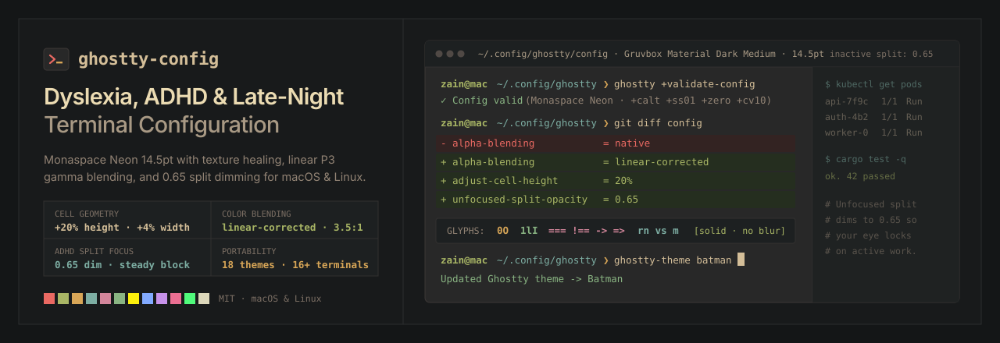

<p align="center">
  
</p>

# Ghostty Config: Dyslexia, ADHD & Late-Night Edition

[](https://github.com/thezaynahmed/ghostty-config/actions/workflows/shell-quality.yml)
[](LICENSE)
[](#themes-22)
[](#supported-terminals-and-editors)

Most terminal configs stop at font and theme, which won't fix color haloing, letter crowding, or split-pane distraction. Built for developers running **Ghostty** and AI coding agents (**Claude Code**, **Cursor**, **Antigravity**, **Codex**, **Windsurf**, **Superset**), this macOS & Linux setup fixes optical fatigue and syncs **16+ terminals and IDEs** from one CLI (`ghostty-theme` / `theme-sync`).

<details>
  <summary>Table of Contents</summary>

- [Why This Exists](#why-this-exists)
- [Quick Start](#quick-start)
- [Universal Theme Switching and Live TUI](#universal-theme-switching-and-live-tui)
- [Shell Icons and Prompt](#shell-icons-and-prompt)
- [Core Ergonomic Settings](#core-ergonomic-settings)
- [Themes (22)](#themes-22)
- [Supported Terminals and Editors](#supported-terminals-and-editors)
- [Contributing and License](#contributing-and-license)

</details>

---

## Why This Exists

Default dark terminal setups stack three real visual bugs: `#000000`/`#FFFFFF` astigmatism halation, tightly packed glyphs that blur stack traces, and uncalibrated ANSI palettes that hide dark-blue CLI flags or turn `git diff` into flat yellow/gray noise.

This repository clones straight into `~/.config/ghostty` and pairs **GitHub Monaspace Texture Healing**, **linear-corrected P3 alpha blending**, **0.65 inactive split dimming**, and **22 contrast-checked themes** led by our original **Gotham Noir** OKLCH/APCA dark family ([`thezaynahmed/gotham-noir`](https://github.com/thezaynahmed/gotham-noir)).

---

## Quick Start

**1. One-line install (macOS & Linux):**

`curl -fsSL https://raw.githubusercontent.com/thezaynahmed/ghostty-config/main/install.sh | bash -s -- --all`

Detects **macOS**, **Fedora**, **Ubuntu**, **Debian**, **Pop!_OS**, **Arch**, and **openSUSE**; installs Ghostty + Monaspace v1.400; links `ghostty-theme` and `theme-sync`; and syncs your installed terminals and IDEs.

**2. Install with an AI Agent:** Paste into **Claude Code**, **Cursor**, **Antigravity**, **Codex**, **Windsurf**, or **Superset**:

```text
Clone https://github.com/thezaynahmed/ghostty-config.git to ~/.config/ghostty, read AGENTS.md, and run ./install.sh --all to configure Ghostty, Monaspace Neon fonts, and my installed terminals and IDEs. Validate with ghostty +validate-config.
```

<details>
  <summary>Targeted install (pick specific tools or Linux Fontconfig)</summary>

```bash
git clone https://github.com/thezaynahmed/ghostty-config.git ~/.config/ghostty
cd ~/.config/ghostty

./install.sh --cursor --vscode --antigravity --superset --warp --tmux --zsh
./install.sh --linux-fontconfig --alacritty --wezterm --kitty
```

</details>

---

## Universal Theme Switching and Live TUI

Use `ghostty-theme` or the tool-agnostic `theme-sync` symlink to switch Ghostty alone or sync **all 12+ detected terminals and IDEs** with `--all` (press `Cmd+Shift+,` on macOS to hot-reload Ghostty):

```bash
theme-sync --list
theme-sync year-one --all        # Gotham Noir - Year One (flagship matte Kevlar + gold)
theme-sync batcomputer --all     # Gotham Noir - Batcomputer (OLED obsidian + emerald)
theme-sync arkham --all          # Gotham Noir - Arkham Slate (3 AM warm zero-glare)
theme-sync vengeance --all       # Gotham Noir - Vengeance (obsidian + crimson flare)
theme-sync gruvbox --all         # Gruvbox Material Dark
theme-sync current               # Read-only active theme check
theme-sync --signal              # Live 78-col Neofetch contrast & ANSI TUI (alias: --fetch)
```

Preview of `theme-sync --signal` (live WCAG 2.1, APCA Lc, R/G hue separation, runtime, and 16-color spectrum readout):

```text
╭────────────────────────────────────────────────────────────────────────────╮
│ ▲ GOTHAM NOIR  /  Year One                        ● ONLINE  ·  LIVE AUDIT  │
├────────────────────────────────────────────────────────────────────────────┤
│     ░░░░░░░░░░░░      │ THEME     Gotham Noir - Year One                   │
│   ░░ ▀▄  ▄▄  ▄▀ ░░    │ PROTOCOL  YEAR-ONE / NOCTURNAL                     │
│  ░░ ████████████ ░░   │ CANVAS    ██ #15171a Kevlar    ██ #d8d6cf          │
│  ░░ ████████████ ░░   │ ACCENT    ██ #f0c946 Signal    ██ #323a46          │
│  ░░  ▀██▀██▀██▀  ░░   │ CONTRAST  12.35:1 AAA · Lc 80.7 · R/G 154deg       │
│   ░░   ▀████▀   ░░    │ RUNTIME   Ghostty · Monaspace Neon 14.5 · zsh      │
│     ░░░░░▀▀░░░░░      │ PROMPT    Starship context · block cursor          │
├────────────────────────────────────────────────────────────────────────────┤
│ PALETTE   8-CHANNEL SPECTRUM (NORMAL / BRIGHT)                             │
│   ██████   ██████   ██████   ██████   ██████   ██████   ██████   ██████    │
│   Kevlar   Crimsn   Oracle   Signal   Detect   Violet   Sonar    Text      │
│   15171a   e86a74   63c794   f0c946   74aeeb   b695e8   68c5ce   d8d6cf    │
├────────────────────────────────────────────────────────────────────────────┤
│ TELEMETRY ✔ 6/6 pods ready · +42 -8 diff · ▲ 0 halation · ● WCAG AAA       │
╰────────────────────────────────────────────────────────────────────────────╯
```

---

## Shell Icons and Prompt

Zsh integrates `eza` (file icons + Git status), `fzf` + `fzf-tab` (icon-aware completion), and 4 optional Starship profiles (`minimal`, `context`, `powerline`, `portable`). Profile state lives outside the repo in `~/.config/ghostty-shell/`. Full setup & Linux notes live in [`docs/shell-icons.md`](docs/shell-icons.md).

```bash
./install.sh --starship context
ghostty-shell doctor && ghostty-shell specimen
ghostty-shell profile powerline   # minimal | context | powerline | portable | off
ghostty-shell icons never         # disable file and completion icons
```

---

## Core Ergonomic Settings

| Setting | Value | Purpose |
| :--- | :--- | :--- |
| `theme` | `Gotham Noir - Year One` | Matte `#15171a` canvas + `#d8d6cf` ink stop glare (`Gruvbox Material Dark Medium` also bundled) |
| `font-family` | `Monaspace Neon` + `Radon` (`14.5pt`) | Clean code face paired with handwritten italic comments |
| `font-feature` | `+calt, +ss01..03, +zero, +cv10` | Texture Healing widens dense letters (`m`, `w`) beside narrow ones (`i`, `l`) |
| `adjust-cell-height` | `20%` (`+4%` width) | Prevents dense logs and stack traces from blurring together |
| `alpha-blending` | `linear-corrected` | Removes fuzzy red/green diff fringes on wide-gamut displays |
| `font-thicken` | `true` (`strength = 100`) | Prevents thin glyph shimmer on high-DPI displays |
| `minimum-contrast` | `3.5` | Lifts dim dark-blue and gray CLI output into legible contrast |
| `unfocused-split-opacity` | `0.65` | Dims inactive splits by 35% to anchor ADHD focus on the active pane |
| `cursor-style-blink` | `false` (`block` + `no-cursor`) | Locks a calm solid block cursor across shells and TUIs |
| `background-blur` | `false` (`opacity = 1`) | Solid opaque canvas with zero desktop bleed-through |

---

## Themes (22)

**15 built-in Ghostty themes** plus **7 custom calibrated files** in [`themes/`](themes/), led by the 4 OKLCH/APCA **Gotham Noir** variants from [`thezaynahmed/gotham-noir`](https://github.com/thezaynahmed/gotham-noir):

| # | Theme | Command | Source | Canvas | Ink |
| :- | :--- | :--- | :--- | :--- | :--- |
| 1 | **`Gotham Noir - Year One`** | `theme-sync year-one` | Bundled Custom | `#15171a` | `#d8d6cf` |
| 2 | **`Gotham Noir - Batcomputer`** | `theme-sync batcomputer` | Bundled Custom | `#101215` | `#dce0e5` |
| 3 | **`Gotham Noir - Arkham Slate`** | `theme-sync arkham` | Bundled Custom | `#1d1f21` | `#dad5c7` |
| 4 | **`Gotham Noir - Vengeance`** | `theme-sync vengeance` | Bundled Custom | `#151417` | `#ddd8d5` |
| 5 | **`Gruvbox Material Dark Medium`** | `theme-sync gruvbox-medium` | Bundled Custom | `#282828` | `#d4be98` |
| 6 | **`Gruvbox Material Dark`** | `theme-sync gruvbox` | Ghostty Builtin | `#282828` | `#d4be98` |
| 7 | **`Night Owl`** | `theme-sync night-owl` | Ghostty Builtin | `#011627` | `#d6deeb` |
| 8 | **`Modus Vivendi Tinted`** | `theme-sync modus` | Ghostty Builtin | `#0d0e1c` | `#ffffff` |
| 9 | **`Ef-Dream`** | `theme-sync ef-dream` | Bundled Custom | `#232025` | `#efd5c5` |
| 10 | **`Ef-Bio`** | `theme-sync ef-bio` | Bundled Custom | `#111111` | `#cfdfd5` |
| 11 | **`Kanagawa Wave`** | `theme-sync kanagawa` | Ghostty Builtin | `#1f1f28` | `#dcd7ba` |
| 12 | **`Kanagawa Dragon`** | `theme-sync dragon` | Ghostty Builtin | `#181616` | `#c5c9c5` |
| 13 | **`Catppuccin Mocha`** | `theme-sync mocha` | Ghostty Builtin | `#1e1e2e` | `#cdd6f4` |
| 14 | **`TokyoNight Storm`** | `theme-sync tokyo` | Ghostty Builtin | `#24283b` | `#c0caf5` |
| 15 | **`Rose Pine`** (`Rosé Pine`) | `theme-sync rose-pine` | Ghostty Builtin | `#191724` | `#e0def4` |
| 16 | **`Rose Pine Moon`** | `theme-sync moon` | Ghostty Builtin | `#232136` | `#e0def4` |
| 17 | **`Everforest Dark Hard`** | `theme-sync everforest` | Ghostty Builtin | `#1e2326` | `#d3c6aa` |
| 18 | **`Dracula`** | `theme-sync dracula` | Ghostty Builtin | `#282a36` | `#f8f8f2` |
| 19 | **`Dracula+`** | `theme-sync dracula+` | Ghostty Builtin | `#212121` | `#f8f8f2` |
| 20 | **`Ayu Mirage`** | `theme-sync ayu` | Ghostty Builtin | `#1f2430` | `#cccac2` |
| 21 | **`Ubuntu`** | `theme-sync ubuntu` | Ghostty Builtin | `#300a24` | `#eeeeec` |
| 22 | **`Matrix II Higher Contrast`** | `theme-sync matrix` | Bundled Custom | `#0f1512` | `#c7f0d2` |

**Dyslexia & Readability Font Presets:** `Monaspace Neon` + `Radon` italics (default), `Monaspace Argon`, `Intel One Mono`, `Atkinson Hyperlegible Mono`, and `Commit Mono`.

---

## Supported Terminals and Editors

| Target | Adapter Path | Command |
| :--- | :--- | :--- |
| **Ghostty** (macOS & Linux) | [`config`](config) + [`themes/`](themes/) | Default |
| **Cursor** | [`adapters/cursor/settings.json`](adapters/cursor/settings.json) | `./install.sh --cursor` |
| **VS Code** | [`adapters/vscode/settings.json`](adapters/vscode/settings.json) | `./install.sh --vscode` |
| **Antigravity** | [`adapters/antigravity/settings.json`](adapters/antigravity/settings.json) | `./install.sh --antigravity` |
| **Windsurf** | [`adapters/windsurf/settings.json`](adapters/windsurf/settings.json) | `./install.sh --windsurf` |
| **Superset** | [`adapters/superset/terminal.json`](adapters/superset/terminal.json) | `./install.sh --superset` |
| **Zed** | [`adapters/zed/settings.json`](adapters/zed/settings.json) | `./install.sh --zed` |
| **Warp** (All 22 Themes) | [`adapters/warp/themes/`](adapters/warp/themes/) | `./install.sh --warp` |
| **Alacritty** | [`adapters/alacritty/alacritty.toml`](adapters/alacritty/alacritty.toml) | `./install.sh --alacritty` |
| **WezTerm** | [`adapters/wezterm/wezterm.lua`](adapters/wezterm/wezterm.lua) | `./install.sh --wezterm` |
| **Kitty** | [`adapters/kitty/kitty.conf`](adapters/kitty/kitty.conf) | `./install.sh --kitty` |
| **Windows Terminal** | [`adapters/windows-terminal/settings.json`](adapters/windows-terminal/settings.json) | Copy into `settings.json` |
| **iTerm2** | [`adapters/iterm2/dyslexia-adhd-profiles.json`](adapters/iterm2/dyslexia-adhd-profiles.json) | `./install.sh --iterm2` |
| **macOS Terminal.app** | [`adapters/macos-terminal/apply-macos-terminal.sh`](adapters/macos-terminal/apply-macos-terminal.sh) | `./install.sh --macos-terminal` |
| **tmux** | [`adapters/tmux/tmux.conf`](adapters/tmux/tmux.conf) | `./install.sh --tmux` |
| **Linux Fontconfig** | [`adapters/linux-fontconfig/70-monaspace-dyslexia.conf`](adapters/linux-fontconfig/70-monaspace-dyslexia.conf) | `./install.sh --linux-fontconfig` |
| **Zsh** | [`adapters/zsh/ade-terminal.zsh`](adapters/zsh/ade-terminal.zsh) | `./install.sh --zsh` |

---

## Contributing and License

- Maintainer: [`@thezaynahmed`](https://github.com/thezaynahmed)
- Contributing & Bug Reports: See [`CONTRIBUTING.md`](CONTRIBUTING.md) or open an issue on [GitHub Issues](https://github.com/thezaynahmed/ghostty-config/issues).
- Independent Project Notice: Gotham Noir is an independent, original open-source color system created by Zain Ahmed and is not affiliated with or endorsed by any studio or publisher.
- License: [MIT](LICENSE)
